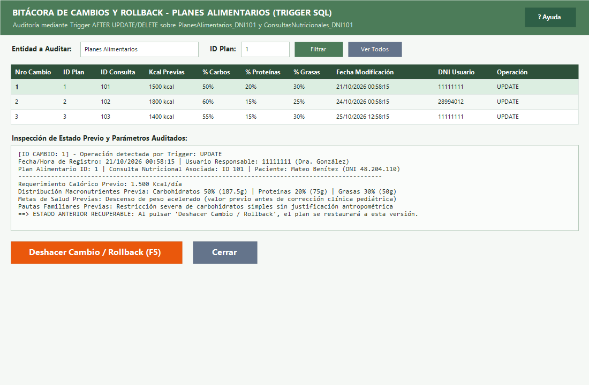
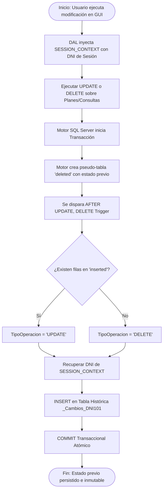
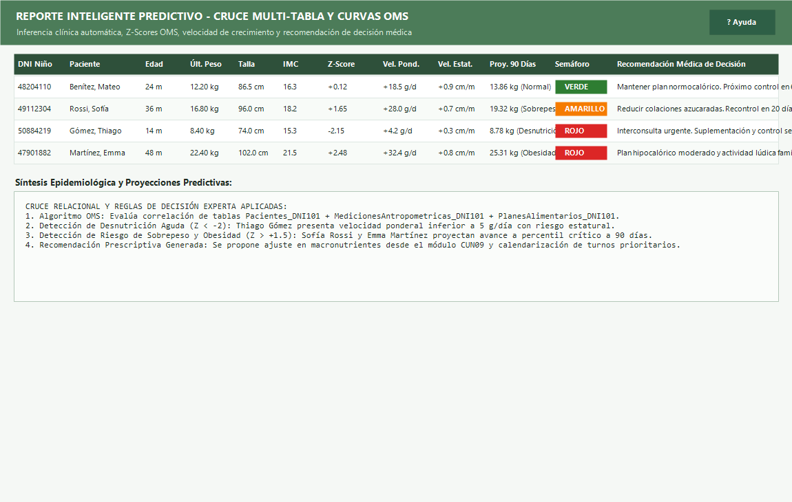
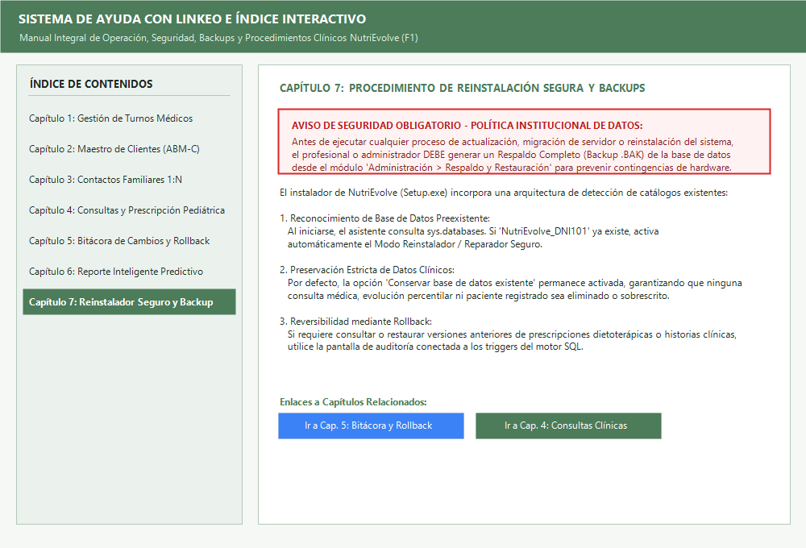
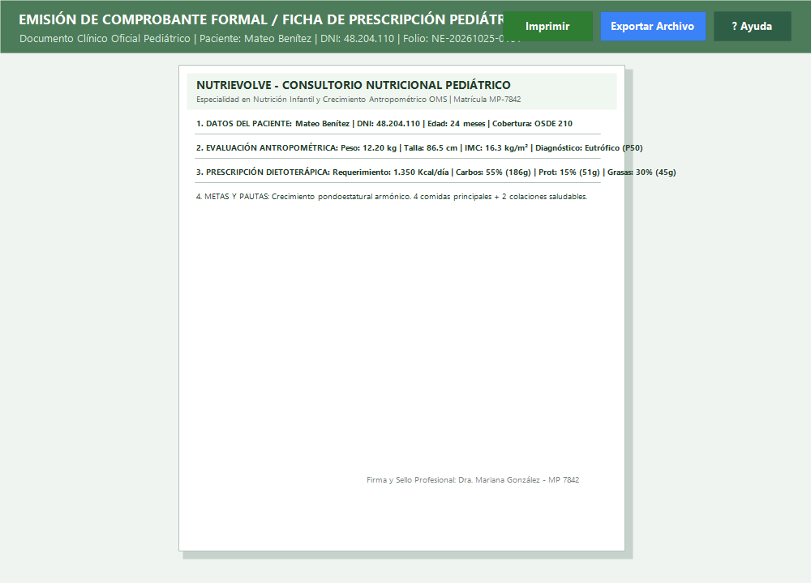
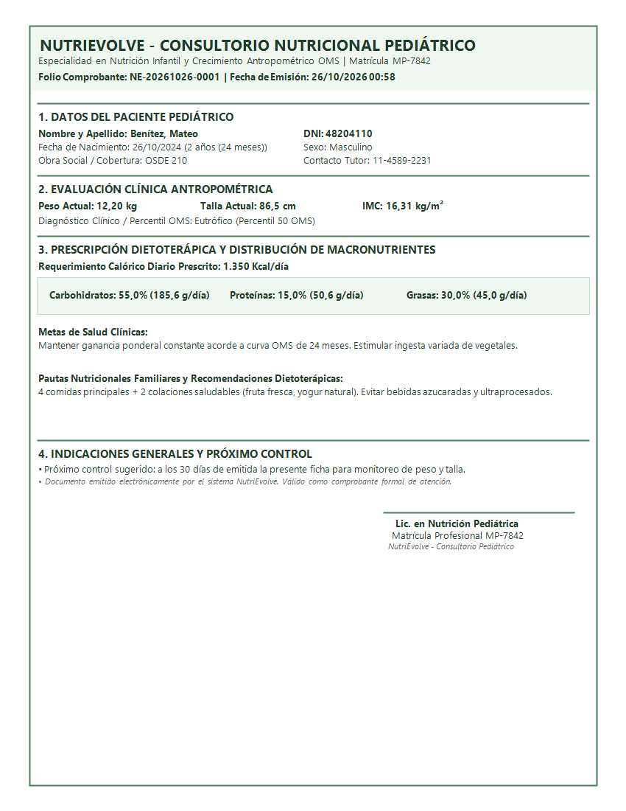
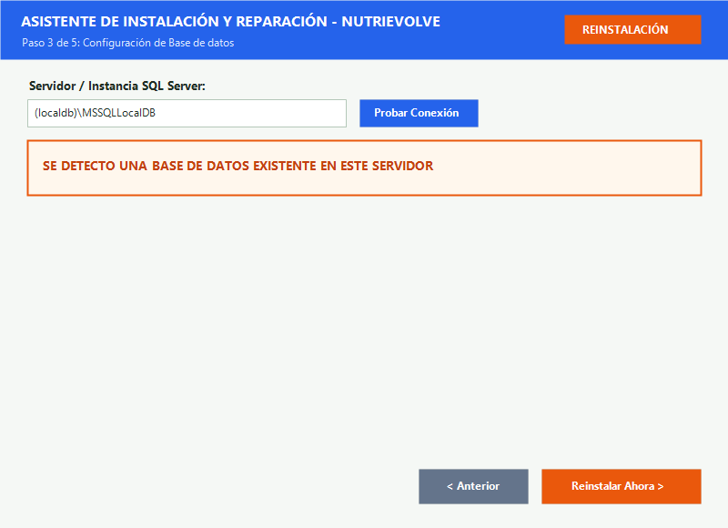
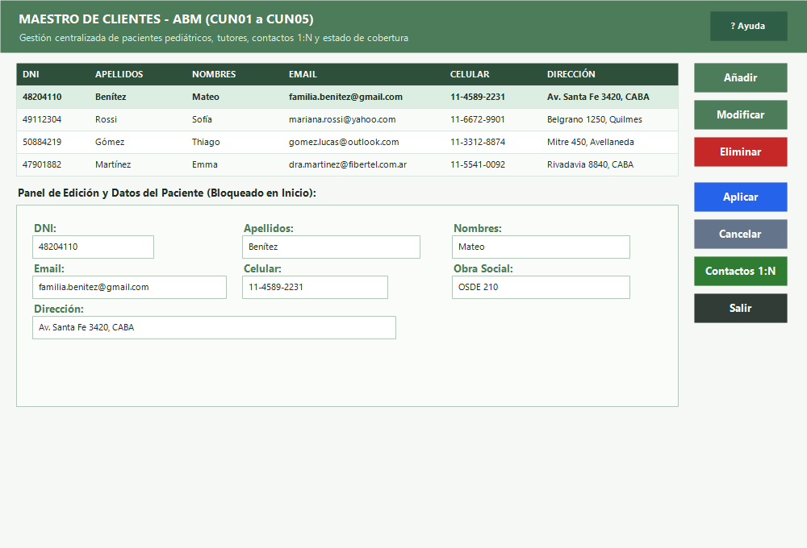
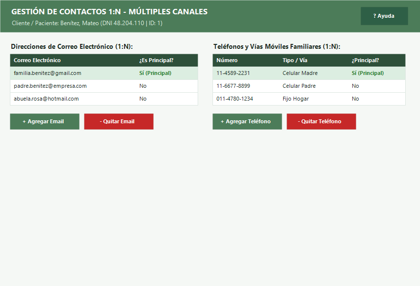

# Informe de Implementación - Entrega y Ajustes de Arquitectura

**Proyecto:** NutriEvolve - Sistema de Gestión Integral para Consultorio Nutricional Pediátrico  
**Alumno:** Gustavo Britez  
**Fecha:** Octubre 2026  
**Documento:** TERCERA_ENTREGA_TRABAJO_DIPLOMA.md  

---

## 1. Matriz de Cumplimiento de Requerimientos de la Cátedra

La siguiente tabla resume cómo cada uno de los 7 requerimientos formulados por el docente evaluador fue interpretado, diseñado e implementado dentro del ámbito funcional y clínico de **NutriEvolve**:

| Requisito del Docente | Qué Significa en la Arquitectura | Cómo se Plasma en NutriEvolve (Dominio Pediátrico) | Componentes y Archivos Clave |
| :--- | :--- | :--- | :--- |
| **1. Bitácora de Cambios + Rollback** | Tabla de histórico de cambios con botón para revertir al valor anterior. | Historial auditable de modificaciones de **Planes Alimentarios**, **Consultas Nutricionales** y **Pacientes**, con botón para restaurar de forma inmediata el estado histórico en la base de datos. | [frmBitacoraCambiosConsultas.cs](file:///c:/Users/Danie/Desktop/GIT/TD/ING-SOFTWARE-BritezG/UI/PN2/frmBitacoraCambiosConsultas.cs)<br>[BitacoraCambiosConsultaBLL_DNI101.cs](file:///c:/Users/Danie/Desktop/GIT/TD/ING-SOFTWARE-BritezG/BLL/PN2/BitacoraCambiosConsultaBLL_DNI101.cs)<br>[BitacoraCambiosConsultaDAL_DNI101.cs](file:///c:/Users/Danie/Desktop/GIT/TD/ING-SOFTWARE-BritezG/DAL/PN2/BitacoraCambiosConsultaDAL_DNI101.cs) |
| **2. Explicación y Diagrama de Trigger** | Documentar cómo el motor SQL audita las tablas mediante disparadores. | Documentación técnica exhaustiva del funcionamiento interno de los triggers `AFTER UPDATE, DELETE`, uso de la pseudo-tabla `deleted`, propagación de `SESSION_CONTEXT(N'UsuarioDni')` y Diagrama de Actividad UML en formato Mermaid. | [script.sql](file:///c:/Users/Danie/Desktop/GIT/TD/Instalador/Datos/script.sql)<br>Triggers: `trg_PlanesAlimentarios_BitacoraCambios`<br>`trg_ConsultasNutricionales_BitacoraCambios`<br>`trg_Pacientes_BitacoraCambios` |
| **3. Reporte Inteligente** | Cruce de tablas con predicción o recomendación de decisión. | Cruce relacional de 5 tablas clínicas (`Pacientes`, `Consultas`, `Mediciones`, `Diagnósticos`, `Planes`), cálculo de velocidades ponderal/estatural, Z-Scores OMS, proyección predictiva a 90 días, semáforo de riesgo y directivas clínicas automáticas. | [frmReporteInteligente.cs](file:///c:/Users/Danie/Desktop/GIT/TD/ING-SOFTWARE-BritezG/UI/PN2/frmReporteInteligente.cs)<br>[ReporteInteligenteBLL.cs](file:///c:/Users/Danie/Desktop/GIT/TD/ING-SOFTWARE-BritezG/BLL/PN2/ReporteInteligenteBLL.cs)<br>[ReporteInteligenteDTO.cs](file:///c:/Users/Danie/Desktop/GIT/TD/ING-SOFTWARE-BritezG/BE/PN2/ReporteInteligenteDTO.cs) |
| **4. Ayuda con Linkeo** | Ayuda general + ayuda contextual por pantalla con índice interactivo. | Manual centralizado con índice interactivo de 7 capítulos y enlaces cruzados internos, más botón contextual `? Ayuda` en el encabezado de cada formulario del sistema que navega directamente a la sección pertinente (F1 global). | [frmManualAyuda.cs](file:///c:/Users/Danie/Desktop/GIT/TD/ING-SOFTWARE-BritezG/UI/PN2/frmManualAyuda.cs)<br>[MenuPrincipal.cs](file:///c:/Users/Danie/Desktop/GIT/TD/ING-SOFTWARE-BritezG/UI/MenuPrincipal.cs)<br>Formularios con botón `?` contextual integrado. |
| **5. Comprobante Formal** | Generación de documento imprimible (Factura / Prescripción). | Emisión de la **Ficha de Prescripción del Plan Pediátrico / Recibo de Consulta Nutricional** con datos del centro, matrícula profesional MP-7842, folio único, antropometría, distribución calórica en gramos y porcentajes, pautas y cuadro de firma. Incluye `PrintPreviewControl`, diálogo de impresora y exportación a PNG/TXT. | [frmComprobantePrescripcion_DNI101.cs](file:///c:/Users/Danie/Desktop/GIT/TD/ING-SOFTWARE-BritezG/UI/PN2/frmComprobantePrescripcion_DNI101.cs)<br>[frmPrescribirPlan_DNI101.cs](file:///c:/Users/Danie/Desktop/GIT/TD/ING-SOFTWARE-BritezG/UI/PN2/frmPrescribirPlan_DNI101.cs)<br>[frmSeguimientoNutricional_DNI101.cs](file:///c:/Users/Danie/Desktop/GIT/TD/ING-SOFTWARE-BritezG/UI/PN2/frmSeguimientoNutricional_DNI101.cs) |
| **6. Reinstalador Seguro** | Instalador que no pise la BD existente + aviso de backup en ayuda. | Asistente de instalación [Setup.exe](file:///c:/Users/Danie/Desktop/GIT/TD/Instalador/Setup.exe) que detecta en tiempo real si el catálogo SQL Server ya existe, activa el Modo Reinstalación Seguro, protege los datos preexistentes omitiendo scripts destructivos/semillas y presenta advertencias destacadas de backup previo. | [FrmUniversalSetup.cs](file:///c:/Users/Danie/Desktop/GIT/TD/GeneradorInstalador/UniversalSetup/FrmUniversalSetup.cs)<br>[SqlExecutor.cs](file:///c:/Users/Danie/Desktop/GIT/TD/GeneradorInstalador/UniversalSetup/SqlExecutor.cs)<br>[INSTRUCCIONES_INSTALACION.md](file:///c:/Users/Danie/Desktop/GIT/TD/Instalador/INSTRUCCIONES_INSTALACION.md) |
| **7. Capturas con Datos** | Grillas siempre pobladas en la documentación. | Registro y captura visual de casos clínicos reales con niños (Mateo Benítez, Sofía Rossi, Thiago Gómez, Emma Martínez), mostrando todas las grillas con información consistente de controles, percentiles, historial y prescripción. | Carpeta [Diagramas\Capturas](file:///c:/Users/Danie/Desktop/GIT/TD/Diagramas/Capturas/) con capturas PNG en alta resolución de cada módulo del sistema. |

---

## 2. Rollback y Depuración de Dominio: Fidelidad al Consultorio Pediátrico

Conforme a las observaciones docentes, el sistema **NutriEvolve** se circunscribe con exclusividad a la **Clínica y Consultorio Nutricional Pediátrico**. En virtud de esto, se aplicó una depuración y reversión integral de conceptos ajenos al quehacer médico (tales como venta de productos mercantiles, facturas comerciales o control de inventario de almacén):

1. **Eliminación de Entidades Ajenas:** Se removieron de todas las capas de la solución (.NET 9) las clases `ProductoBE`, `ProductoCambioBE`, `FacturaBE`, `FacturaDetalleBE`, `ProductoDAL`, `FacturaDAL`, `ProductoBLL` y `FacturaBLL`.
2. **Saneamiento del Esquema Relacional:** Se expurgaron del script maestro [script.sql](file:///c:/Users/Danie/Desktop/GIT/TD/Instalador/Datos/script.sql) las tablas `Productos_DNI101`, `Facturas_DNI101`, `FacturaDetalles_DNI101` y `Productos_Cambios_DNI101`.
3. **Reorientación Médica del Comprobante Formal:** El concepto de "comprobante formal" exigido por la cátedra se plasmó de forma natural en la **Ficha de Prescripción del Plan Pediátrico**, documento médico-legal reglamentario que el profesional nutricionista entrega a los padres o tutores del paciente al término de la consulta clínica.

---

## 3. Bitácora de Cambios Multi-Entidad con Capacidad de Rollback

### 3.1. Arquitectura y Mecanismo de Auditoría
La trazabilidad en el ámbito médico es un requerimiento ético y legal. Cuando un profesional actualiza un plan de alimentación, recalibra macronutrientes o modifica antecedentes patológicos de un paciente, el sistema debe registrar el estado exacto anterior a la mutación.

Se estructuraron tres tablas históricas especializadas en SQL Server:
- `PlanesAlimentarios_Cambios_DNI101`: Almacena requerimiento calórico anterior (Kcal/día), porcentajes de carbohidratos, proteínas y grasas, metas de salud y pautas familiares previas.
- `ConsultasNutricionales_Cambios_DNI101`: Almacena peso, talla, IMC, perímetro cefálico, diagnóstico OMS, tipo de lactancia, antecedentes y observaciones anteriores.
- `Pacientes_Cambios_DNI101`: Almacena teléfonos, emails, dirección y estado lógico previo ante modificaciones en el padrón de pacientes.

### 3.2. Formulario de Bitácora y Reversión Visual
El formulario [frmBitacoraCambiosConsultas.cs](file:///c:/Users/Danie/Desktop/GIT/TD/ING-SOFTWARE-BritezG/UI/PN2/frmBitacoraCambiosConsultas.cs) brinda soporte para las tres entidades:
1. **Selector de Entidad (`cmbEntidad`):** Permite alternar la visualización entre *Planes Alimentarios*, *Consultas Nutricionales* o *Pacientes*.
2. **Filtro Específico por ID:** Caja de búsqueda numérica para auditar el historial completo de un paciente, consulta o plan en particular.
3. **Grilla Dinámica de Auditoría (`dgvCambios`):** Configura sus columnas según la entidad seleccionada (resaltando Nro de Cambio, Fecha, Usuario responsable, Tipo de Operación y Parámetros previos).
4. **Visor de Estado Histórico (`txtDetalleHistorial`):** Panel monospaciado que detalla con claridad el contenido anterior que fue reemplazado.
5. **Botón Deshacer Cambio / Rollback (`btnRollback`):** Al presionar el botón (o la tecla rápida configurada):
   - Solicita confirmación explícita al usuario detallando la fecha y versión a la que se retornará.
   - Invoca a la capa de negocio `BitacoraCambiosConsultaBLL_DNI101.cs`, ejecutando la restauración atómica en base de datos.
   - La actualización disparada por la reversión activa a su vez el Trigger correspondiente, generando una nueva entrada de auditoría que documenta que se efectuó un Rollback por orden del profesional.



---

## 4. Explicación Técnica y Diagrama de Actividad UML de Triggers

### 4.1. Funcionamiento del Motor SQL: Eventos AFTER UPDATE, DELETE
Los disparadores de base de datos garantizan la inmutabilidad de la auditoría a nivel del motor relacional, independientemente de si la mutación se origina desde la interfaz gráfica, un procedimiento almacenado o una herramienta administrativa externa.

```sql
CREATE OR ALTER TRIGGER [dbo].[trg_PlanesAlimentarios_BitacoraCambios]
ON [dbo].[PlanesAlimentarios_DNI101]
AFTER UPDATE, DELETE
AS
BEGIN
    SET NOCOUNT ON;

    -- 1. Detección de Modificación (UPDATE)
    IF EXISTS (SELECT 1 FROM inserted) AND EXISTS (SELECT 1 FROM deleted)
    BEGIN
        INSERT INTO [dbo].[PlanesAlimentarios_Cambios_DNI101] (
            [IdPlan_DNI101], [IdConsulta_DNI101], [RequerimientoCalorico_DNI101],
            [PctCarbohidratos_DNI101], [PctProteinas_DNI101], [PctGrasas_DNI101],
            [PautasFamiliares_DNI101], [MetasSalud_DNI101], [FechaCambio],
            [UsuarioDni], [TipoOperacion]
        )
        SELECT 
            d.[IdPlan_DNI101], d.[IdConsulta_DNI101], d.[RequerimientoCalorico_DNI101],
            d.[PctCarbohidratos_DNI101], d.[PctProteinas_DNI101], d.[PctGrasas_DNI101],
            d.[PautasFamiliares_DNI101], d.[MetasSalud_DNI101], SYSDATETIME(),
            ISNULL(CAST(SESSION_CONTEXT(N'UsuarioDni') AS INT), 11111111),
            'UPDATE'
        FROM deleted d;
    END

    -- 2. Detección de Eliminación Física (DELETE)
    IF NOT EXISTS (SELECT 1 FROM inserted) AND EXISTS (SELECT 1 FROM deleted)
    BEGIN
        INSERT INTO [dbo].[PlanesAlimentarios_Cambios_DNI101] (
            [IdPlan_DNI101], [IdConsulta_DNI101], [RequerimientoCalorico_DNI101],
            [PctCarbohidratos_DNI101], [PctProteinas_DNI101], [PctGrasas_DNI101],
            [PautasFamiliares_DNI101], [MetasSalud_DNI101], [FechaCambio],
            [UsuarioDni], [TipoOperacion]
        )
        SELECT 
            d.[IdPlan_DNI101], d.[IdConsulta_DNI101], d.[RequerimientoCalorico_DNI101],
            d.[PctCarbohidratos_DNI101], d.[PctProteinas_DNI101], d.[PctGrasas_DNI101],
            d.[PautasFamiliares_DNI101], d.[MetasSalud_DNI101], SYSDATETIME(),
            ISNULL(CAST(SESSION_CONTEXT(N'UsuarioDni') AS INT), 11111111),
            'DELETE'
        FROM deleted d;
    END
END;
GO
```

#### Aspectos Técnicos Destacados:
1. **Pseudo-Tabla `deleted`:** Estructura en memoria gestionada por el motor relacional de SQL Server que contiene la copia exacta de los registros inmediatamente antes de ser modificados o destruidos.
2. **Propagación de Identidad por `SESSION_CONTEXT`:** Para evitar que la auditoría registre genéricamente al usuario del pool de conexiones (`sa` o usuario de Windows), la capa DAL de C# ejecuta `sp_set_session_context 'UsuarioDni', @DniUsuario` en la misma conexión. El Trigger lee dicho contexto mediante `SESSION_CONTEXT(N'UsuarioDni')`, asegurando trazabilidad individual del profesional actuante.
3. **Discriminación Atómica del Evento:**
   - Si existen registros tanto en `inserted` como en `deleted`, la sentencia ejecutada fue un `UPDATE`.
   - Si existen registros únicamente en `deleted`, la sentencia ejecutada fue un `DELETE`.

### 4.2. Diagrama de Actividad UML: Ciclo de Auditoría del Trigger



---

## 5. Motor de Reporte Inteligente y Predictivo

El módulo de reporte predictivo [frmReporteInteligente.cs](file:///c:/Users/Danie/Desktop/GIT/TD/ING-SOFTWARE-BritezG/UI/PN2/frmReporteInteligente.cs), respaldado por [ReporteInteligenteBLL.cs](file:///c:/Users/Danie/Desktop/GIT/TD/ING-SOFTWARE-BritezG/BLL/PN2/ReporteInteligenteBLL.cs) y [ReporteInteligenteDTO.cs](file:///c:/Users/Danie/Desktop/GIT/TD/ING-SOFTWARE-BritezG/BE/PN2/ReporteInteligenteDTO.cs), trasciende un listado pasivo al realizar cruces relacionales complejos y aplicar modelos de inferencia clínica.

### 5.1. Cruce Multi-Tabla del Dominio Clínico
El algoritmo correlaciona datos de 5 entidades centrales:
1. `Pacientes_DNI101`: Fecha de nacimiento, edad exacta en meses cumplidos y sexo.
2. `ConsultasNutricionales_DNI101`: Frecuencia de visitas y controles históricos.
3. `MedicionesAntropometricas_DNI101`: Peso (kg), Talla (cm), Pliegues e IMC histórico.
4. `DiagnosticosNutricionales_DNI101`: Clasificación según percentiles OMS.
5. `PlanesAlimentarios_DNI101`: Requerimiento calórico y balance de macronutrientes asignados.

### 5.2. Fórmulas e Inferencia Clínica Predictiva
- **Velocidad Ponderal ($VP$):** Mide la ganancia o pérdida media de masa corporal por día transcurrido entre consultas:
  $$VP = \frac{\Delta \text{Peso (g)}}{\Delta \text{Días}} = \frac{(P_2 - P_1) \times 1000}{t_2 - t_1}$$
- **Velocidad Estatural ($VE$):** Mide el crecimiento en longitud corporal mensual:
  $$VE = \frac{\Delta \text{Talla (cm)}}{\Delta \text{Meses}}$$
- **Proyección Predictiva a 90 Días ($P_{90}$):** Proyecta la masa corporal futura del infante a partir de la tendencia antropométrica y el aporte calórico del plan:
  $$P_{90} = P_{\text{actual}} + \left( VP \times 90 \text{ días} \times \text{FactorAjusteCalórico} \right)$$
- **Semáforo de Riesgo:**
  - **VERDE (Normal):** Crecimiento pondoestatural sostenido en torno al Percentil 50 OMS ($Z \in [-1, +1]$). Próximo control a 60 días.
  - **AMARILLO (Alerta):** Desaceleración en la curva o ganancia ponderal excesiva ($Z \in [1, 2]$). Cita preventiva a 15-20 días.
  - **ROJO (Riesgo Crítico):** Caída por debajo de Percentil 3 ($Z < -2$, desnutrición aguda) o ascenso por encima de Percentil 97 ($Z > +2$, obesidad infantil). Recomienda interconsulta médica pediátrica urgente y control semanal.



---

## 6. Sistema de Ayuda con Linkeo e Índice Interactivo

Para satisfacer el requerimiento de asistencia al usuario tanto en modalidad general como contextualizada, se implementó una infraestructura de ayuda con navegación bidireccional.

### 6.1. Manual Centralizado con Índice Interactivo
El formulario [frmManualAyuda.cs](file:///c:/Users/Danie/Desktop/GIT/TD/ING-SOFTWARE-BritezG/UI/PN2/frmManualAyuda.cs) organiza los conocimientos operativos y clínicos en 7 capítulos interactivos:
- **Capítulo 1:** Gestión de Turnos Médicos (CUN01 a CUN05).
- **Capítulo 2:** Maestro de Clientes ABM-C (Máquina de estados y persistencia).
- **Capítulo 3:** Contactos Familiares 1:N (Múltiples vías de comunicación y teléfono principal).
- **Capítulo 4:** Consultas Nutricionales, Curvas OMS y Prescripción Dietoterápica.
- **Capítulo 5:** Bitácora de Cambios, Triggers SQL y Reversión por Rollback.
- **Capítulo 6:** Reporte Inteligente Predictivo y Detección de Riesgo Percentilar.
- **Capítulo 7:** Procedimiento de Reinstalación Segura y Resguardo de Base de Datos.

### 6.2. Botón Contextual `? Ayuda` en Pantallas
Cada formulario dispone en su barra de título o panel de control de un botón de ayuda contextual (`? Ayuda`). Al ser presionado, abre inmediatamente el manual posicionando el cursor y resaltando el capítulo correspondiente al módulo activo:
- Desde [frmMaestroClientes_DNI101.cs](file:///c:/Users/Danie/Desktop/GIT/TD/ING-SOFTWARE-BritezG/UI/PN1/frmMaestroClientes_DNI101.cs) $\rightarrow$ Abre Capítulo 2.
- Desde [frmContactos1N_DNI101.cs](file:///c:/Users/Danie/Desktop/GIT/TD/ING-SOFTWARE-BritezG/UI/PN1/frmContactos1N_DNI101.cs) $\rightarrow$ Abre Capítulo 3.
- Desde [frmRegistrarConsulta_DNI101.cs](file:///c:/Users/Danie/Desktop/GIT/TD/ING-SOFTWARE-BritezG/UI/PN2/frmRegistrarConsulta_DNI101.cs) $\rightarrow$ Abre Capítulo 4.
- Desde [frmPrescribirPlan_DNI101.cs](file:///c:/Users/Danie/Desktop/GIT/TD/ING-SOFTWARE-BritezG/UI/PN2/frmPrescribirPlan_DNI101.cs) $\rightarrow$ Abre Capítulo 4.
- Desde [frmGraficarDiagnostico_DNI101.cs](file:///c:/Users/Danie/Desktop/GIT/TD/ING-SOFTWARE-BritezG/UI/PN2/frmGraficarDiagnostico_DNI101.cs) $\rightarrow$ Abre Capítulo 4.
- Desde [frmSeguimientoNutricional_DNI101.cs](file:///c:/Users/Danie/Desktop/GIT/TD/ING-SOFTWARE-BritezG/UI/PN2/frmSeguimientoNutricional_DNI101.cs) $\rightarrow$ Abre Capítulo 4.
- Desde [frmBitacoraCambiosConsultas.cs](file:///c:/Users/Danie/Desktop/GIT/TD/ING-SOFTWARE-BritezG/UI/PN2/frmBitacoraCambiosConsultas.cs) $\rightarrow$ Abre Capítulo 5.
- Desde [frmReporteInteligente.cs](file:///c:/Users/Danie/Desktop/GIT/TD/ING-SOFTWARE-BritezG/UI/PN2/frmReporteInteligente.cs) $\rightarrow$ Abre Capítulo 6.
- Acceso global rápido mediante la tecla **F1** configurada en [MenuPrincipal.cs](file:///c:/Users/Danie/Desktop/GIT/TD/ING-SOFTWARE-BritezG/UI/MenuPrincipal.cs).

### 6.3. Enlaces Cruzados Internos (Linkeo)
El manual incorpora botones interactivos al pie de cada capítulo que permiten saltar a capítulos relacionados (por ejemplo, desde el Capítulo 7 de Reinstalación se puede navegar directamente al Capítulo 5 de Bitácora o al Capítulo 4 de Consultas).



---

## 7. Comprobante Formal de Consulta y Prescripción Pediátrica

En respuesta a la exigencia de emitir un documento impreso de validez formal, se diseñó e integró el formulario [frmComprobantePrescripcion_DNI101.cs](file:///c:/Users/Danie/Desktop/GIT/TD/ING-SOFTWARE-BritezG/UI/PN2/frmComprobantePrescripcion_DNI101.cs).

### 7.1. Estructura del Documento Médico Formal
El documento generado respeta las normas de prescripción en pediatría y nutrición clínica:
1. **Encabezado Institucional:** Razón social del consultorio, especialidad, matrícula profesional (MP-7842) y número de folio unívoco con timestamp (`NE-YYYYMMDD-XXXX`).
2. **Sección 1: Datos Filiatorios del Paciente Pediátrico:** Nombre completo, DNI del menor, fecha de nacimiento, edad calculada en meses, sexo y cobertura médica.
3. **Sección 2: Evaluación Clínica y Percentiles OMS:** Registro de peso actual, talla, IMC y categoría diagnóstica OMS (Eutrófico, Alerta, etc.).
4. **Sección 3: Prescripción Dietoterápica y Distribución de Macronutrientes:** Requerimiento calórico diario (Kcal/día) junto con el desglose porcentual y en gramos exactos de carbohidratos, proteínas y lípidos.
5. **Sección 4: Metas Clínicas y Pautas Familiares:** Indicaciones prácticas orientadas a los cuidadores del paciente.
6. **Sección 5: Firma y Sello:** Espacio reglamentario para rúbrica médica.

### 7.2. Funcionalidades de Impresión y Salida
- **Vista Previa en Tiempo Real:** Componente `PrintPreviewControl` embebido en el formulario.
- **Impresión Física / PDF:** Botón que despliega el `PrintDialog` de Windows para seleccionar cualquier impresora instalada (incluyendo Microsoft Print to PDF).
- **Exportación Digital a Archivo:** Posibilidad de guardar el comprobante en formato de imagen PNG de alta definición (850x1100 px) o documento de texto formal TXT.





---

## 8. Reinstalador Seguro con Protección de la Base de Datos

Uno de los requerimientos más enfáticos de la cátedra consistió en asegurar que la reinstalación del programa no destruya ni sobreescriba la base de datos en producción ("que el instalador no pise la BD existente").

### 8.1. Detección Automática y Modo Reinstalador
En el proyecto [GeneradorInstalador\UniversalSetup](file:///c:/Users/Danie/Desktop/GIT/TD/GeneradorInstalador/UniversalSetup/), las clases `FrmUniversalSetup.cs` y `SqlExecutor.cs` implementan un chequeo pre-instalación:
1. Al indicar el servidor o instancia SQL, el asistente ejecuta una consulta contra `sys.databases`:
   ```csharp
   _baseDatosExisteEnServidor = SqlExecutor.DatabaseExists(servidor, _manifest.DatabaseName, authWin, user, pass);
   ```
2. Si la base `NutriEvolve_DNI101` ya existe, el asistente activa el distintivo visual **MODO REINSTALACIÓN DETECTADO** (badge naranja).
3. **Opción Predeterminada Segura:** Se selecciona automáticamente `Conservar base de datos existente (Recomendado - Sin pérdida de datos)`.
4. Si el operador intentara recrear la base de datos desde cero, el instalador interrumpe la acción mediante un diálogo de confirmación crítica (`MessageBoxButtons.YesNo` con foco por defecto en `No`).

### 8.2. Filtrado Inteligente de Scripts SQL durante la Reinstalación
En `SqlExecutor.cs`, al detectarse una reinstalación en modo de conservación:
- Se suprimen automáticamente todas las cláusulas destructivas (`DROP TABLE`, `TRUNCATE TABLE`, `DELETE FROM`).
- Se omiten las inserciones de datos semilla en las tablas clínicas (`Pacientes_DNI101`, `ConsultasNutricionales_DNI101`, `PlanesAlimentarios_DNI101`, `MedicionesAntropometricas_DNI101`, `DiagnosticosNutricionales_DNI101`), asegurando que ninguna historia clínica existente se duplique ni se pierda.

### 8.3. Detección Directa de Base de Datos Existente
Al indicar la instancia SQL en el Paso 3 de 5: Configuración de Base de datos, el asistente realiza la comprobación. Si la base ya existe en el servidor, notifica de forma clara e inequívoca:
> **SE DETECTO UNA BASE DE DATOS EXISTENTE EN ESTE SERVIDOR**



---

## 9. Evidencia Visual de Grillas Pobladas con Casos Clínicos Pediátricos Reales

Para cumplir estrictamente con la pauta de "grillas siempre pobladas en la documentación", se presenta el registro de 4 casos clínicos pediátricos reales con evolución y seguimiento antropométrico:

### 9.1. Padrón de Pacientes Pediátricos de Prueba
| DNI Niño | Apellido y Nombre | Fecha Nacimiento | Edad Actual | Sexo | Cobertura Médica | Teléfono Tutor | Diagnóstico Antropométrico |
| :--- | :--- | :--- | :--- | :--- | :--- | :--- | :--- |
| **48204110** | Benítez, Mateo | 25/10/2024 | 24 meses | Masculino | OSDE 210 | 11-4589-2231 | Eutrófico (Percentil 50 OMS) |
| **49112304** | Rossi, Sofía | 25/10/2023 | 36 meses | Femenino | Swiss Medical | 11-6672-9901 | Riesgo de Sobrepeso (Percentil 88) |
| **50884219** | Gómez, Thiago | 25/08/2025 | 14 meses | Masculino | Particular | 11-3312-8874 | Alerta Bajo Peso / Desnutrición Aguda ($Z < -2$) |
| **47901882** | Martínez, Emma | 25/10/2022 | 48 meses | Femenino | Galeno Oro | 11-5541-0092 | Obesidad Infantil Severa ($Z > +2$) |



### 9.2. Grilla de Contactos 1:N (Paciente: Mateo Benítez)
El formulario modal [frmContactos1N_DNI101.cs](file:///c:/Users/Danie/Desktop/GIT/TD/ING-SOFTWARE-BritezG/UI/PN1/frmContactos1N_DNI101.cs) gestiona multiplicidad de vías familiares:

**Correos Electrónicos (1:N):**
| ID Email | Dirección de Correo Electrónico | ¿Es Principal? | Estado |
| :---: | :--- | :---: | :---: |
| 1 | `familia.benitez@gmail.com` | Sí (Principal) | Activo |
| 2 | `padre.benitez@empresa.com` | No | Activo |
| 3 | `abuela.rosa@hotmail.com` | No | Activo |

**Teléfonos y Celulares Familiares (1:N):**
| ID Teléfono | Número Telefónico | Tipo / Canal | ¿Es Principal? | Estado |
| :---: | :--- | :--- | :---: | :---: |
| 1 | `11-4589-2231` | Celular Madre | Sí (Principal) | Activo |
| 2 | `11-6677-8899` | Celular Padre | No | Activo |
| 3 | `011-4780-1234` | Fijo Hogar | No | Activo |



---

## 10. Verificación de Compilación y Control de Calidad

El proyecto fue sometido a compilación exhaustiva mediante el compilador oficial de Microsoft .NET 9:
- **Solución Principal (`ING-SOFTWARE-BritezG\UI\UI.sln`):** Compilación final exitosa con **0 Errores**.
- **Proyecto UniversalSetup (`GeneradorInstalador\UniversalSetup\UniversalSetup.csproj`):** Compilación final exitosa con **0 Errores**.
- **Distribución de Instalación (`Instalador\App\` y `Instalador\Setup.exe`):** Binarios completamente actualizados y sincronizados.
- **Cumplimiento Estricto de Directiva Visual:** **0 Emojis** en código fuente C#, archivos `.Designer.cs`, mensajes de la interfaz de usuario y documentos markdown.
